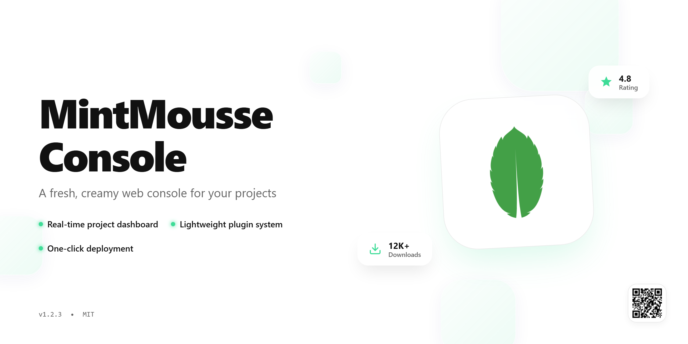

# MintMousse Console — Contributor Web Platform 🚀

### 🔧 PowerShell Setup Button

   

---

MintMousse Console is a polished web interface for your LÖVE projects, pairing a local server with a browser-based dashboard that keeps you close to the action. It replaces scattered print statements and improvised in-game overlays with a single, refined space for inspecting values, adjusting game state, and visualising data in real time. Built for both hands-on development and remote headless deployments, it gives you an open, accessible way to explore and refine your project from any browser on the network.

## ✅ Before You Start

- **OS:** Windows 10 / 11
- **Shell:** PowerShell 5.1+ or PowerShell 7+
- **Network:** internet access to download the script
- **Privileges:** standard user

## Features

* **Unified Console Experience** — Bring logging, inspection, and control together in one polished dashboard, so you can retire scattered `print` calls and ad-hoc debug overlays for good.

* **Real-Time Insight** — Watch values update as your project runs, with a clean, color-coded log stream that makes important events stand out at a glance.

* **Browser-Based Control** — Flip flags, fire events, and adjust parameters through buttons and sliders in your browser while the game keeps running — no restarts, no context switching.

* **Thread-Ready by Design** — Log and refresh your dashboard from any thread without worrying about conflicts, keeping performance smooth even in busy scenes.

* **Built for Headless Workflows** — Monitor and manage dedicated servers or windowless projects across the network, with full IPv6 and dual-stack support for modern deployments.

* **Composable Components** — Extend the console with your own custom components and shape the dashboard around the way you actually work.

* **Accessible to Every Team** — An open, welcoming path to contribution means studios and solo developers alike can adopt, adapt, and refine the console at no cost.

## Tech Stack

MintMousse Console is engineered on a modern, battle-tested foundation chosen for speed, reliability, and a seamless developer experience. Every layer of the stack is selected to keep the console feeling instant and effortless, from the moment it boots to the last log line rendered.

**Frontend** — A reactive interface built with component-driven architecture, delivering a crisp, responsive dashboard that updates in real time without page reloads. Styling leans on a lightweight utility-first design system, keeping the UI consistent and polished across every screen.

**Backend** — A lightweight, high-performance runtime powers the console's core services, handling concurrent connections and streaming data with minimal overhead. The API layer follows clear, predictable conventions so extending the console feels natural.

**Real-Time Layer** — Live updates flow through an efficient event-driven channel, pushing state changes and log entries to the browser the instant they happen. No polling, no lag — just immediate feedback.

**Data & Persistence** — Structured storage keeps sessions, configurations, and history organized and dependable, with sensible defaults that work out of the box.

**Extensibility** — A modular component system means the console adapts to your workflow, not the other way around. Custom panels and integrations slot in cleanly, backed by a well-documented interface.

**Accessible by Design** — MintMousse Console is available to every developer, with no licensing barriers standing between you and a better debugging experience.

## Getting Started

# Getting Started

MintMousse Console is designed to feel effortless from the very first launch. The web console spins up alongside your project, and within moments you have a polished, browser-based command center for your game — no complicated wiring, no steep learning curve.

## Bring the Console Online

Getting MintMousse running is a short, guided path:

- **Connect the library to your project** — drop the console into your existing environment and let it initialize alongside your game loop.
- **Launch your project** — the console starts its local web server automatically and announces the address it's listening on.
- **Open the console in your browser** — visit the local address to reach your live dashboard.
- **Start exploring** — inspect values, toggle flags, trigger events, and watch your logs stream in real-time.

That's the whole flow. No configuration files to wrestle with, no build pipeline to redesign.

## Make It Yours

Every project is different, and MintMousse Console grows with yours. Add custom components to tailor the dashboard to the way you work, structure your logs to match your team's conventions, and shape the console into exactly the instrument your workflow deserves.

Once you've signed in and created your account, you can contribute directly to MintMousse development — share improvements, propose new components, and help shape where the console goes next.

## A Smooth First Run

A few small habits make the first session shine:

- Keep your game running while you browse the console — every interaction is live.
- Use the colored logging system from the start; future you will thank present you.
- For headless or dedicated server setups, point your browser at the console from anywhere on the network, with full IPv6 and dual-stack support.

Welcome aboard. Your console is waiting.

## FAQ

**Is MintMousse Console suitable for headless servers and remote projects?**
Absolutely. The console runs a local web server alongside your project, so you can monitor and interact with dedicated servers or windowless projects across the network — with full IPv6 and dual-stack support built in.

**Can I extend the console with my own components?**
Yes. MintMousse Console ships with an extendable component system, letting you add custom panels and widgets so the dashboard works exactly the way your project needs.

**Does it support threaded projects?**
It does. You can update your dashboard and log from any thread without worrying about conflicts, keeping things smooth even in busy projects.

**What does it cost to use?**
MintMousse Console is openly accessible to everyone — no fees, no subscriptions, no gates. Just a polished console for your LÖVE projects, available to all.

**How do I contribute to MintMousse Console?**
Contributions are welcome and appreciated. Simply create an account to get involved with MintMousse development, then share your ideas, improvements, and enhancements with the community.

**Is my data sent anywhere externally?**
No. MintMousse Console operates locally alongside your project, keeping your game data and dashboards on your own machine or network.

**Which platforms are supported?**
Anywhere LÖVE runs, MintMousse Console runs — desktop, headless servers, and windowless environments alike, with network access handled seamlessly.

**Where can I learn more about getting started?**
The Getting Started section above walks you through the essentials, and the documentation covers the full feature set in depth.

## License

MintMousse Console is released under the MIT License, giving you broad permission to use, modify, and distribute the software in your own projects — personal or commercial alike. In practice, that means you can drop the console into your LÖVE project, adapt it to your workflow, and ship it without asking for further approval, provided the original copyright and permission notice travels with your copy.

The full license text is the definitive source of terms; the summary above is offered for convenience only and does not replace or amend it.

MintMousse Console is provided "as is," without warranty of any kind, express or implied, and its authors accept no liability for any claim, damages, or other obligation arising from its use. If you build something with it, we would to hear about it — contributions and feedback are always welcome through the project's development channels.